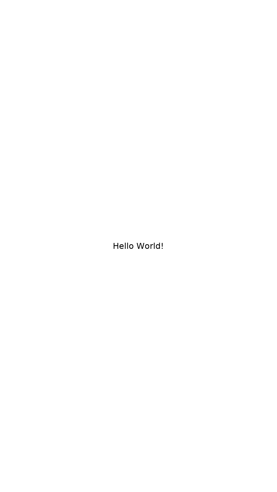

# Darling Pocket: iOS apps on Android phones

Goal: an ordinary Android app (`darling-pocket`) that runs unmodified arm64 iOS
apps (`.ipa`) on an arm64 phone, fullscreen and touch-driven, on top of this
Darling tree. It is a phone runtime, not a desktop: no window chrome, no menus,
no pointer-first UI. Mac software is not a goal of this branch.

This branch (`ios` on Kreijstal/darling) carries the iOS layer. The Android
app, its build of the host binaries and its display bridge live in a separate
`darling-pocket` repository that pins this branch as a submodule, the way
[aosp-pocket](https://github.com/Kreijstal/aosp-pocket) pins its sources.
Generic iOS work (UIKit classes, loader fixes) should also go upstream to
VibeDarling, so this branch stays a thin layer over it.

## What already holds

- **The loader takes iOS binaries.** Darling's dyld is Apple's, including the
  path that runs iPhone apps on Apple Silicon Macs: on arm64 an executable
  built for `PLATFORM_IOS` is accepted, macOS dylibs may load into it, and
  `/System/iOSSupport` becomes a root path (`src/external/dyld/dyld3/MachOFile.cpp`,
  `loadableIntoProcess`; `src/external/dyld/src/dyld2.cpp`, the platform switch
  that sets `rootPaths`). Darling installs UIKit there.
- **Measured on x86_64:** the ios-android-runtime Hello World sample, unmodified
  source, built for Mac Catalyst and linked against
  `/System/Library/Frameworks/UIKit.framework/UIKit`, runs: dyld redirects UIKit
  to `/System/iOSSupport`, `didFinishLaunching` and `viewDidLoad` run, and the X11
  backend under Xvfb shows the centred label in a frameless window. The same
  binary marked `PLATFORM_IOS` fails to find UIKit on x86_64, as the code above
  predicts (the iOS root path is arm64-only).
- **Measured on arm64: an unmodified iOS IPA runs.** The same sample's IPA as
  Theos built it (arm64, `PLATFORM_IOS`, iOS 14 deployment target, SDK 16.5,
  `LC_DYLD_INFO_ONLY` binds) runs on a Raspberry Pi 4 under this tree
  cross-built from x86_64: dyld loads UIKit from `/System/iOSSupport`,
  `didFinishLaunching` and `viewDidLoad` run and the label is drawn centred
  (X11 backend, display tunnelled from Xvfb). It took three fixes: a generic
  ARMv8.0 CPU baseline for compiled Mach-O code (`DARLING_ARM64_CPU`), dyld2
  instead of closure mode for iOS executables (darling-dyld), and the iOS
  `NSTextAlignment` numbering on arm64 (darling-cocotron).

  
- **Non-root mode for Android exists** (`src/startup/darling.c`: no namespaces,
  the prefix a plain directory, the real procfs), along with bionic/Termux build
  support in mldr, darlingserver and the launcher. Termux is an ordinary app
  sandbox, which is the strongest evidence so far that darlingserver's
  `process_vm_readv`/`process_vm_writev` work for an app UID. It has not been
  measured inside our own APK yet.
- **Graphics building blocks:** IOSurface in `iokitd`, Metal to Vulkan through
  Indium and mslc, and Android has Vulkan.

## Phases

Each phase ends with a run of a real binary, not only a build.

### 1. arm64 iOS binaries on arm64 Linux

- Done: cross build on x86_64 against a copy of the target's `/usr` as sysroot,
  with a CMake toolchain file for `aarch64-unknown-linux-gnu` and
  `-DTARGET_ARM64=ON -DTARGET_x86_64=OFF -DTARGET_i386=OFF`; the Theos-built
  Hello World IPA runs unmodified (above).
- Next: the chained-fixups variant of the same IPA
  (`make package FIXUP_CHAINS=1`), and the multi-image and table-view samples.
- Add an `.app` launcher: take the executable from `CFBundleExecutable`, give
  the app an iOS-shaped container (`Documents`, `Library`, `tmp`) as its home,
  and make `[NSBundle mainBundle]` work with the **flat iOS bundle layout**
  (`Info.plist` at the bundle root, no `Contents/`). Check Foundation's NSBundle
  for that layout first.

### 2. UIKit for a phone

UIKit currently sits on AppKit: a UIView is an NSView, and a UIWindow hosts a
borderless NSWindow. This stays for now because it gives working drawing,
text and a display backend today. What changes is what the app sees:

- `UIScreen` reports the phone's pixel size and scale from the host, not an
  NSScreen of a desktop.
- Touch: host touches become `UITouch`/`UIEvent` delivered through
  `touchesBegan:`/`Moved`/`Ended`/`Cancelled` and hit-testing, not mouse events.
- Lifecycle: the host activity's resume/pause/stop map to
  `applicationDidBecomeActive`/`WillResignActive`/`DidEnterBackground`;
  safe-area insets come from the host.
- Breadth, in the order apps need it: `UIButton`, `UIImageView`, `UIScrollView`,
  `UITableView` (port the working one from ios-android-runtime,
  `src/uikit/tableview.cpp`), `UINavigationController`, `UITextField` with the
  host keyboard, compiled nibs and storyboards.
- Later: UIView backed by CALayer instead of NSView, once QuartzCore can
  composite; needed for animation and for apps that use layers directly.

System services, the part of SpringBoard that apps talk to. Their interfaces
are copied on a best-effort basis from class-dumped headers. With no
FrontBoard or runningboardd behind them yet, each call does its work in the
calling process (`tests/ios-board-services.m` covers all three):

- GraphicsServices: `GSEventRunModal` and its run loop mode stack, screen
  info, event timestamps. GSEvents themselves have been dead since iOS 7.
- RunningBoardServices: process handles, identifiers and predicates (found
  through `kern.proc.all` and `proc_pidpath`, with the bundle taken from the
  executable's enclosing `.app`), and assertions that are recorded but not
  enforced.
- FrontBoardServices: `FBSSystemService` finds an installed app by bundle
  identifier in `/Applications`, `/var/containers/Bundle/Application/*/` and
  `~/Applications`, launches it with `posix_spawn`, gives its pid, and
  terminates it. Scene settings are only value objects so far.
- Still to come: a FrontBoard-lite in one process that owns the display and
  sends apps their lifecycle (foreground, background, suspend). The
  darling-pocket launcher would sit on top of it.

### 3. Android display backend

A third Cocotron backend next to `X11.backend` and `Wayland.backend`:

- One fullscreen surface per UIWindow; Cocotron renders with cairo into a
  shared-memory buffer (memfd) that the host maps; damage rectangles and
  frame-ready notifications over a socket.
- The host side draws that buffer into a SurfaceView. aosp-pocket already does
  this for its guest compositor ("anonymous shared frame buffers", "reusable
  host GPU buffers"); reuse it.
- Input in the other direction: touches, keyboard, IME text, back button.
- The X11 and Wayland ELF wrappers are not built for Android; freetype,
  fontconfig, png, jpeg and cairo come from NDK builds shipped in the APK.

### 4. darling-pocket APK

- Build `darling` (launcher), `mldr` and `darlingserver` with the NDK. Android
  forbids exec from app data, so they ship as `lib*.so` in `nativeLibraryDir`,
  as aosp-pocket does for its loader.
- The Mach-O runtime (the installed `libexec/darling` tree) is downloaded or
  extracted into app storage on first start, checksum-pinned.
- Keep the prefix path short: darlingserver's socket path must fit in
  `sun_path` (108 bytes); a long prefix fails with "darlingserver socket path is
  too long".
- Foreground service to keep the container alive, a manager UI, and IPA import
  (unzip `Payload/*.app` into the container).
- First measurement in an APK: darlingserver's cross-process memory calls under
  the `untrusted_app` SELinux domain.

### 5. Breadth

Swift apps (the Swift runtime is in-tree), Metal through Indium on Android
Vulkan, audio through AAudio instead of PulseAudio, networking and the
keychain.

## Limits to state up front

- **App Store IPAs are FairPlay-encrypted.** Their code cannot run anywhere but
  an iPhone that holds the keys. Darling Pocket runs decrypted, ad hoc,
  development or open-source IPAs. Apple's binaries are never shipped.
- arm64e (pointer authentication) is out of scope; plain arm64 apps only.
- The guest runs as the host app's UID with no isolation between guest
  processes, like aosp-pocket.
